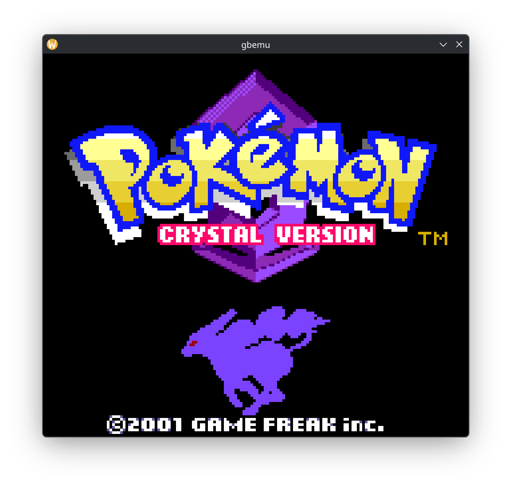
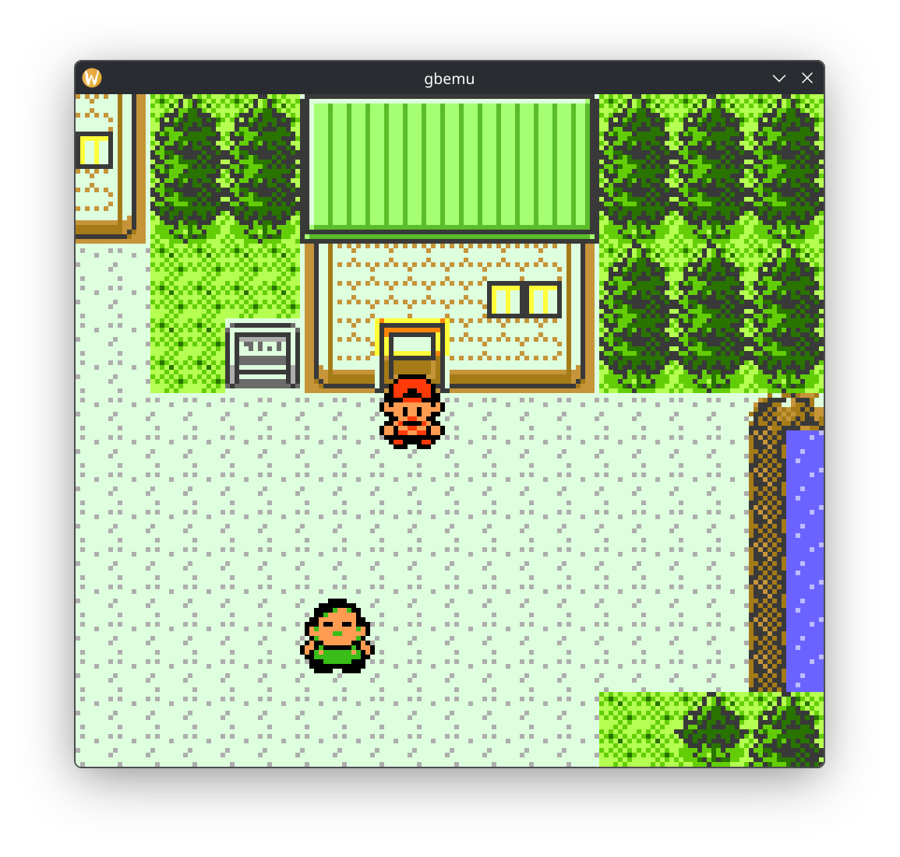
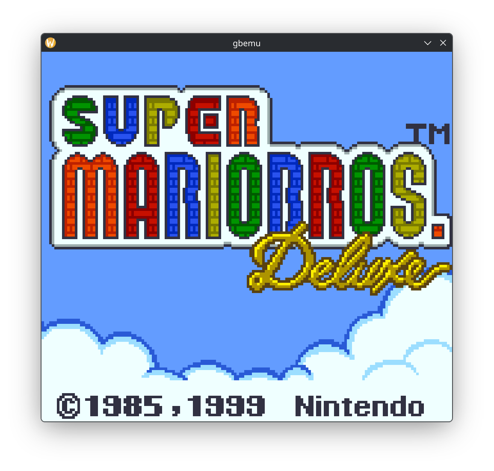
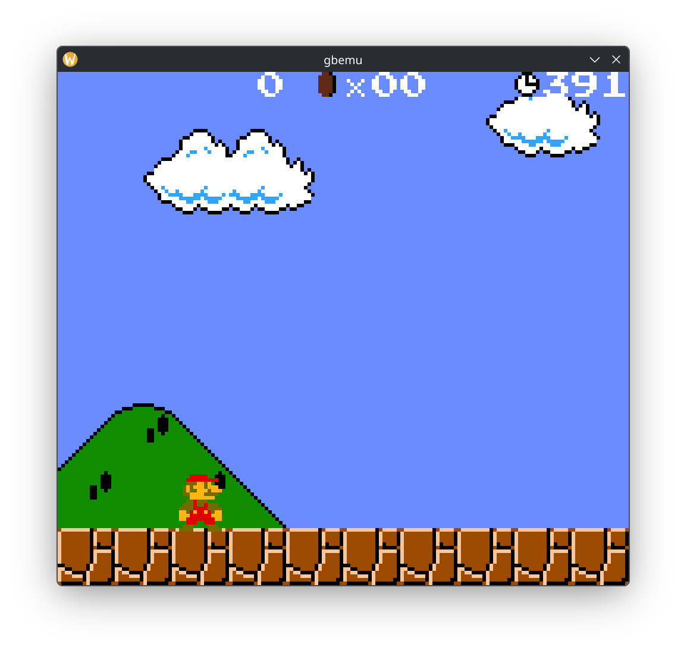
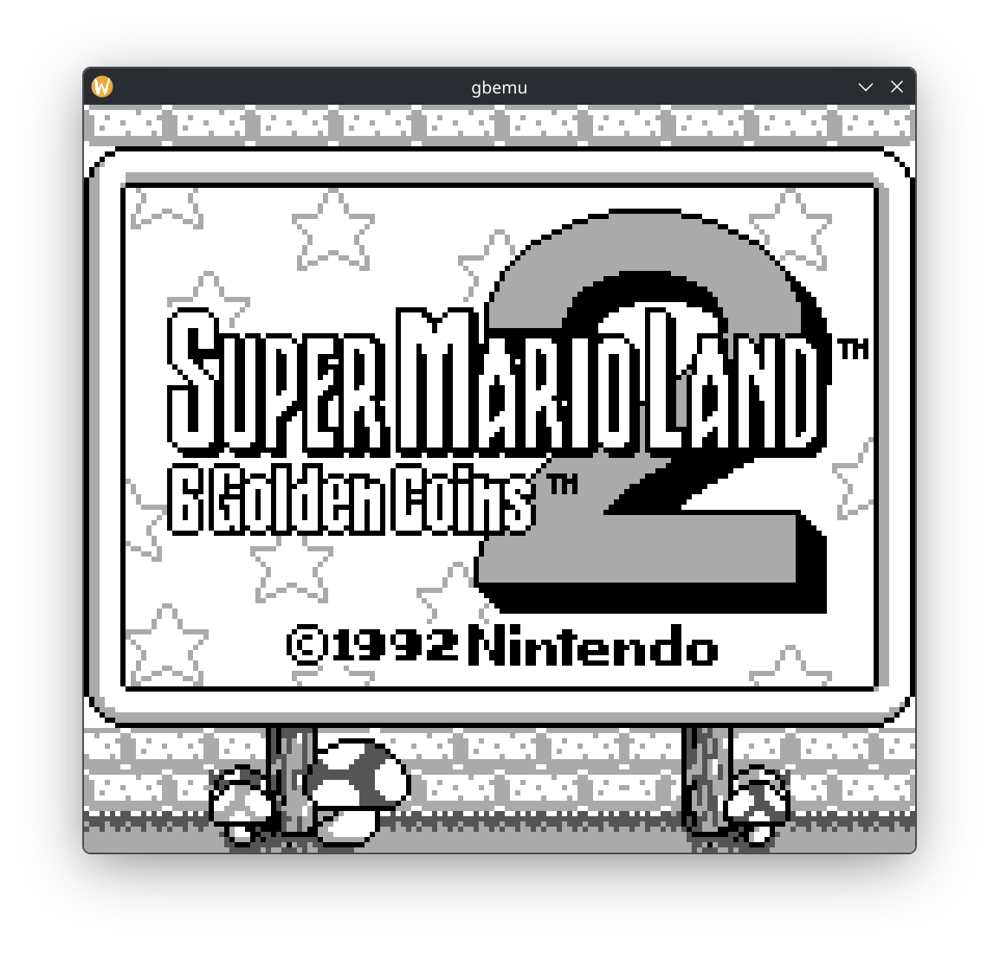
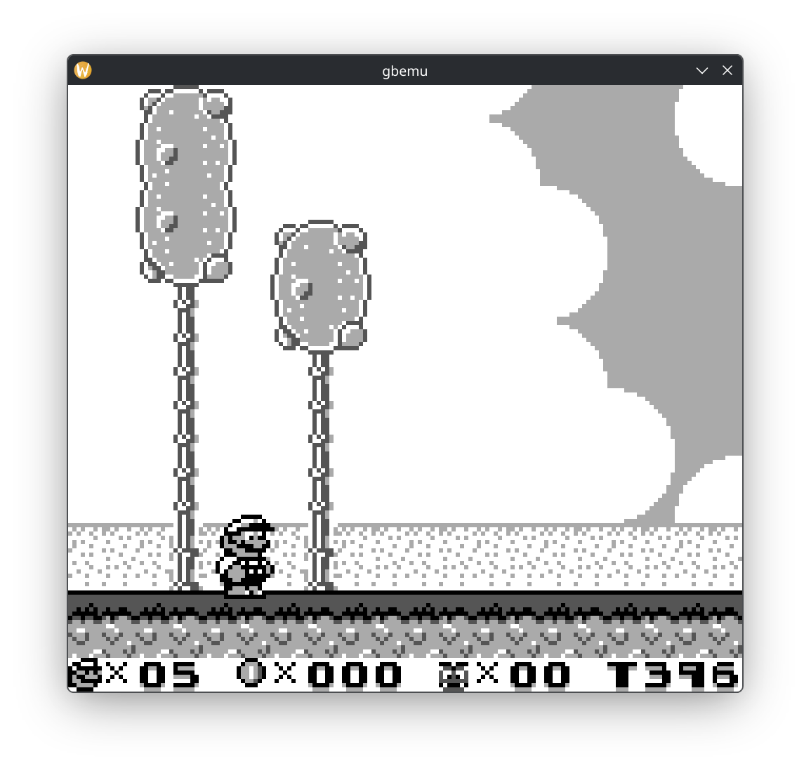

# Game Boy Emulator

This is a Game Boy and Game Boy Color emulator written in C++17 with a Qt 6 desktop frontend.
The project includes CPU, memory, cartridge, timer, graphics, input, audio,
and Super Game Boy components.

## Features

- Game Boy and Game Boy Color cartridge support
- Cartridge controllers: ROM-only, MBC1, MBC2, MBC3, and MBC5
- Qt-rendered display and keyboard controls
- Qt menu bar with a native file dialog for opening and closing ROMs
- Stereo audio output through Qt Multimedia
- Battery-backed cartridge RAM saved beside the ROM
- Settings window (saved as JSON) for your own Game Boy and Game Boy Color BIOS files (not included)
- Hardware setting to run every game on the original Game Boy (DMG)
- Video settings: window size, scaling, Game Boy colors, Super Game Boy border, and full screen
- Audio settings: output device, volume, and mute
- Remappable keyboard controls
- Pause, reset, and fast-forward

Emulation coverage is still evolving, so compatibility varies by game.

## Screenshots

| Pokémon Crystal | Pokémon Crystal |
| --- | --- |
|  |  |

| Super Mario Bros. Deluxe | Super Mario Bros. Deluxe |
| --- | --- |
|  |  |

| Super Mario Land 2 | Super Mario Land 2 |
| --- | --- |
|  |  |

## Requirements

- C++17-compatible compiler: GCC 9 or newer, Clang 9 or newer
- CMake 3.23 or newer
- Qt 6 development packages with the Widgets and Multimedia modules
- On Windows: [MSYS2](https://www.msys2.org/), building from the **UCRT64** shell

## Build

From the repository root:

```sh
cmake -B build
cmake --build build --parallel
```

The executable is created at `build/gbemu` (`build/gbemu.exe` on Windows).

### Windows (MSYS2 UCRT64)

Windows builds are only supported from the MSYS2 **UCRT64** shell. Install the
compiler, CMake and Qt there:

```sh
pacman -S --needed mingw-w64-ucrt-x86_64-gcc mingw-w64-ucrt-x86_64-cmake \
    mingw-w64-ucrt-x86_64-qt6-base mingw-w64-ucrt-x86_64-qt6-multimedia
```

Use `mingw-w64-ucrt-x86_64-cmake`, not the plain `cmake` package: that one is
built for the MSYS environment and fails to configure Qt.

Then build with the same commands as above. Run `build/gbemu.exe` from the
UCRT64 shell so it can find the Qt and GCC DLLs.

## Run

```sh
./build/gbemu
```

Use **File > Open ROM...** to browse for a `.gb`, `.gbc`, or `.sgb` file. Double-click
a folder to enter it, or type a path into the bar at the top of the browser and press Enter.
Double-click a ROM or select it and click **Open** to start it. The game pauses while
the browser is open. **File > Close ROM** saves battery-backed RAM and stops the game.

When a game starts, its title, the console it runs on, its cartridge type, and its ROM and RAM
sizes show over the picture for 3 seconds.

### BIOS (boot ROMs)

gbemu does not include any BIOS. Every game starts by running a real boot ROM, which you
supply yourself: a 256-byte Game Boy (DMG) BIOS and, for Game Boy Color games, a 2304-byte
Game Boy Color BIOS. Open **Settings > Settings...** and, on the
**BIOS** page, use **Browse** to choose the **GB BIOS file** and **GBC BIOS file**. If a game needs
a BIOS that hasn't been chosen, gbemu offers to open Settings when the game is opened.

The **Emulation** page picks the hardware. **Automatic** runs Game Boy Color games as a Game Boy
Color, Super Game Boy games on a Super Game Boy, and everything else as a Game Boy. **Game Boy (DMG)
for every game** runs every game on the original Game Boy, which some test ROMs (such as the OAM
corruption tests) need. The page also sets the fast-forward speed (2× to 8×) and whether the game
pauses while another window is active.

The **Emulation** menu pauses the game (**Pause**, Ctrl+P) and restarts it as if the console were
switched off and on (**Reset**, Ctrl+R).

The **Video** page sets the window size (1× to 8× the Game Boy's screen), how the picture is
scaled (fit the window, whole multiples only, or stretched), the colors original Game Boy games
are shown in (gray, green, or Game Boy Pocket), and whether the Super Game Boy border is shown.
Video settings take effect straight away. **View > Full Screen** (F11) shows only the picture;
Escape leaves it.

The **Audio** page picks the output device (**System default** follows the device your system
uses), the volume, and mute. If the chosen device is unplugged, the system default plays until it
is plugged back in.

Settings are saved as JSON in `settings.json` in your user configuration folder
(`%LOCALAPPDATA%\gbemu` on Windows, `~/.config/gbemu` on Linux).

A ROM can also be passed on the command line:

```sh
./build/gbemu path/to/game.gbc
```

gbemu starts a copy of itself that runs on its own and returns right away, so the shell gets its
prompt back. The copy doesn't depend on the terminal: closing the terminal doesn't close gbemu,
and gbemu prints nothing to it.

### Keyboard controls

The default keys are below. To change them, open the **Input** page in Settings, click a button,
and press the new key (Escape cancels). **Restore Defaults** puts these back.

| Game Boy button | Keyboard |
| --- | --- |
| D-pad | W, A, S, D |
| A | P |
| B | O |
| Select | Backspace |
| Start | Enter |
| Fast-forward (hold) | Space |

When the cartridge has battery-backed RAM, the emulator stores it in a
`.battery` file next to the ROM. For example, `game.gb` uses `game.gb.battery`.

## Project layout

- `Source/` — `Core/` holds the emulator (no Qt), `Frontend/` the Qt application, and `Main.cpp` starts it
- `CMakeLists.txt` — build configuration

## Contributing

Contributions and bug reports are welcome. Open an issue to describe a
compatibility problem or proposed change, or submit a pull
request with a focused improvement.
