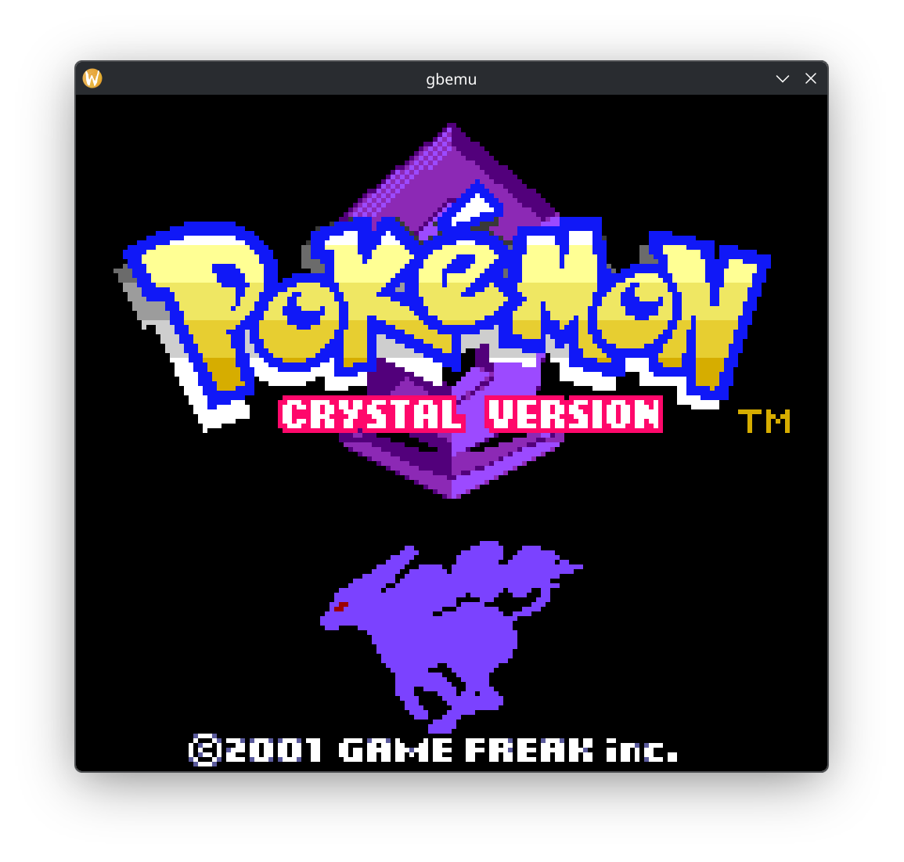
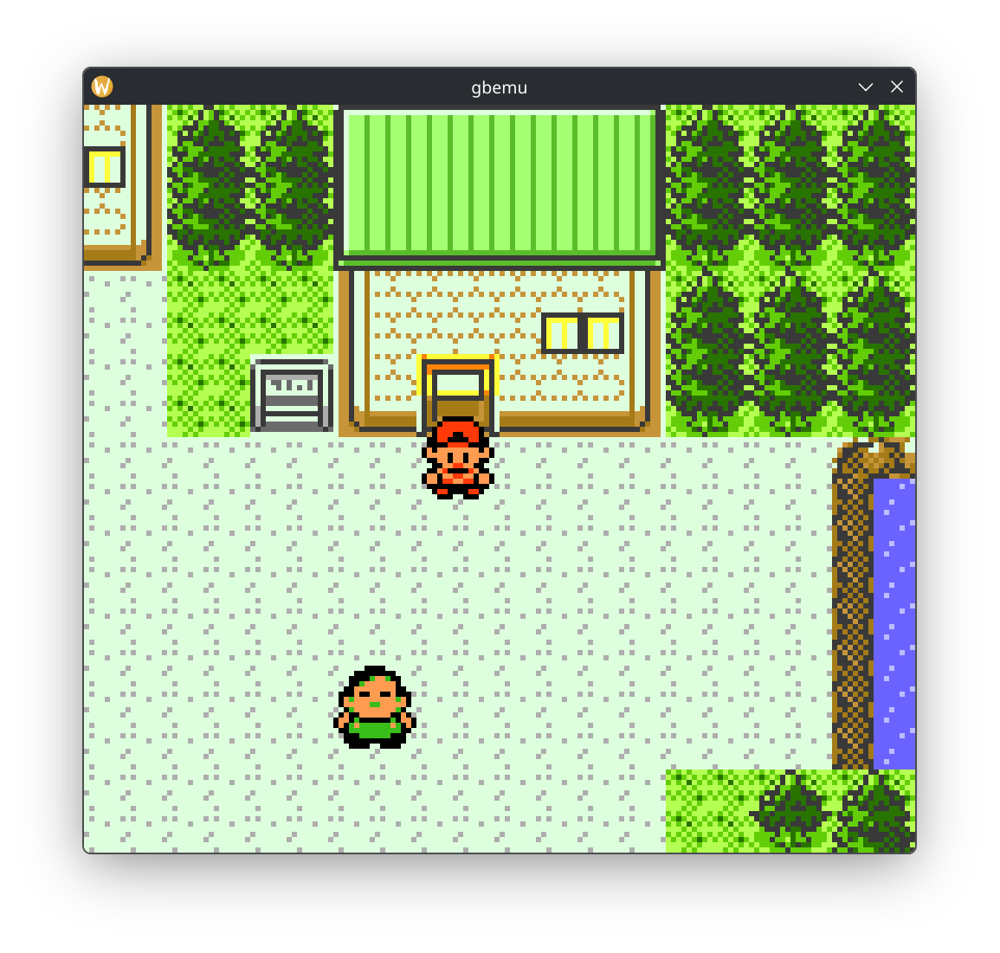
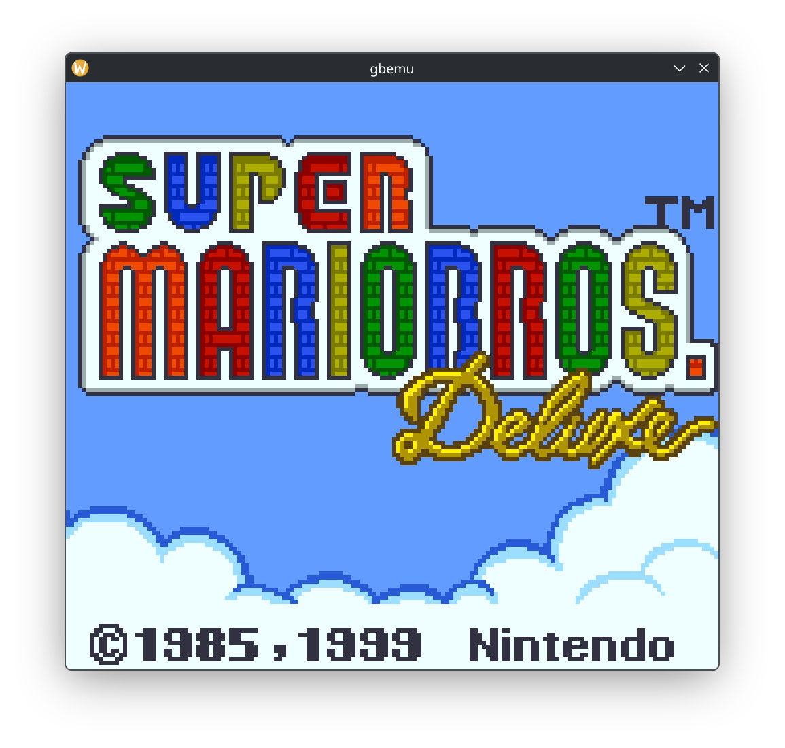
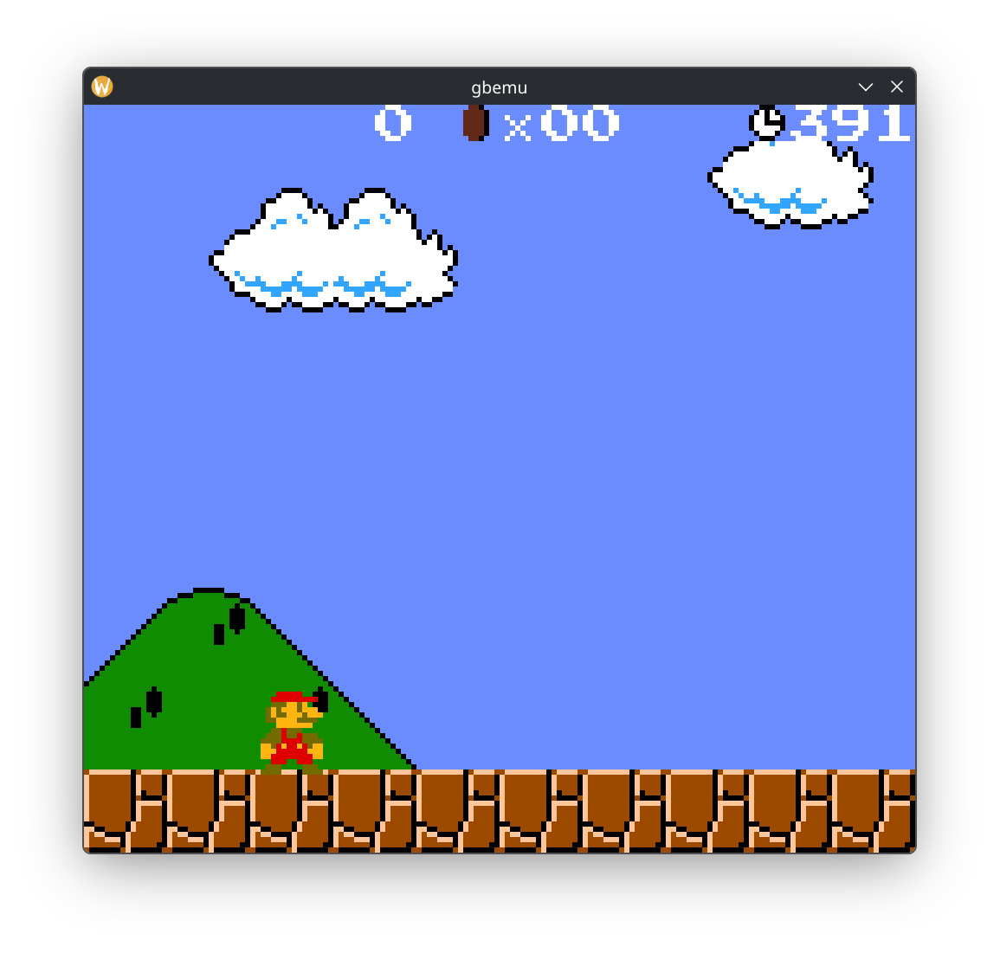
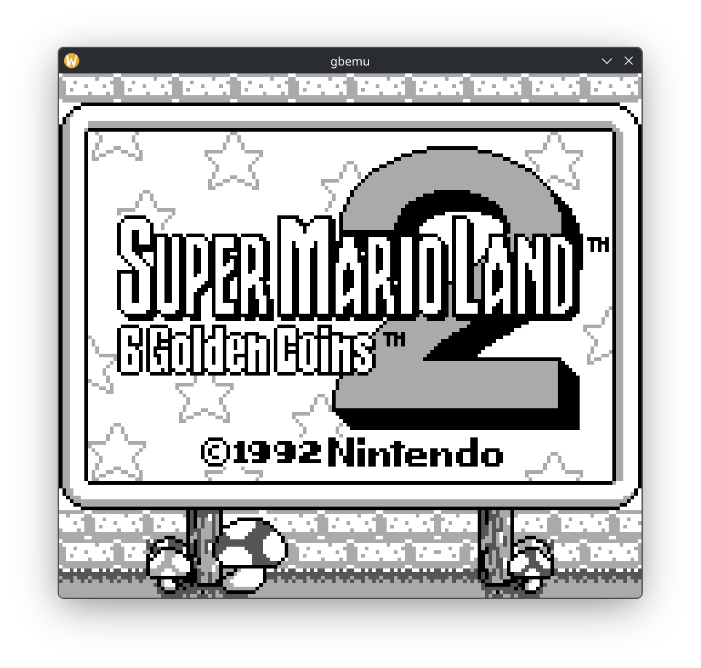
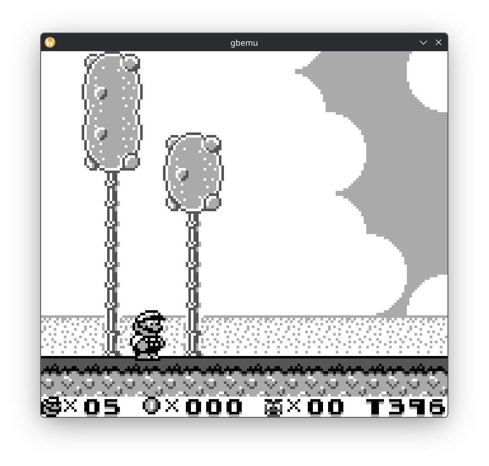

# Game Boy Emulator

This is a Game Boy and Game Boy Color emulator written in C++14 with an SDL desktop frontend.
The project includes CPU, memory, cartridge, timer, graphics, input, audio,
and Super Game Boy components.

## Features

- Game Boy and Game Boy Color cartridge support
- Cartridge controllers: ROM-only, MBC1, MBC2, MBC3, and MBC5
- SDL-rendered display and keyboard controls
- Stereo audio output through SDL
- Battery-backed cartridge RAM saved beside the ROM
- Optional Game Boy Color boot ROM

Emulation coverage is still evolving, so compatibility varies by game.

## Screenshots

| Pokémon Crystal | Pokémon Crystal |
| --- | --- |
|  |  |

| Super Mario Bros. Deluxe | Super Mario Bros. Deluxe |
| --- | --- |
|  |  |

| Super Mario Land 2 | Super Mario Land 2 |
| --- | --- |
|  |  |

## Requirements

- C++14-compatible compiler: GCC 5.4 or newer, Clang 3.4 or newer
- CMake 3.23 or newer
- SDL2 development package with CMake package configuration

## Build

From the repository root:

```sh
cmake -S . -B build
cmake --build build
```

The executable is created at `build/gbemu` (on Windows, it may be `build/Debug/gbemu.exe`
or `build/Release/gbemu.exe`, depending on the generator).

## Run

```sh
./build/gbemu path/to/game.gb
```

To provide a Game Boy Color boot ROM, pass it as the second argument:

```sh
./build/gbemu path/to/game.gbc path/to/cgb_boot.bin
```

The boot ROM is optional. ROM files are read from disk as supplied.

### Keyboard controls

| Game Boy button | Keyboard |
| --- | --- |
| D-pad | W, A, S, D |
| A | P |
| B | O |
| Select | Backspace |
| Start | Enter |

When the cartridge has battery-backed RAM, the emulator stores it in a
`.battery` file next to the ROM. For example, `game.gb` uses `game.gb.battery`.

## Project layout

- `src/` — emulator core and SDL application
- `CMakeLists.txt` — build configuration

## Contributing

Contributions and bug reports are welcome. Open an issue to describe a
compatibility problem or proposed change, or submit a pull
request with a focused improvement.
